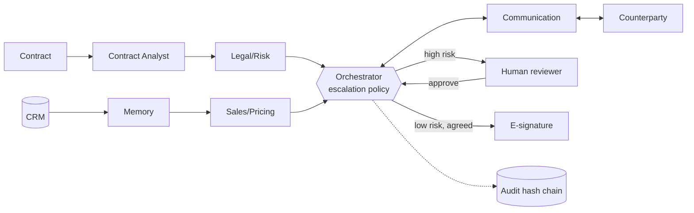

# CoNexus - Contract Negotiation Executive System

**A Risk-Aware, Memory-Augmented Multi-Agent Framework for Autonomous B2B Contract Lifecycle Automation**

Final Year Capstone, Dept. of CSE, KIET Group of Institutions (AKTU)
Team: Arnav Singh Tomar, Taniya Sumbul, Yash Tiwari, Priyanshi | Supervisor: Dr. Ashima Arya

CoNexus reads a customer's contract, finds risky clauses, negotiates price and terms using
CRM history, signs low-risk deals on its own, and hands high-risk decisions to a human.
Every decision goes into a tamper-evident audit log.

---

## Architecture



Full diagrams (system, deployment, request flow, state machine) and the API reference:
**[docs/ARCHITECTURE.md](docs/ARCHITECTURE.md)**.

| Research objective | Component | Code |
|---|---|---|
| RO1 multi-agent coordination over shared state | 6 agents + Orchestrator over `NegotiationState` | [conexus/agents/](conexus/agents/), [orchestrator.py](conexus/orchestrator.py) |
| RO2 risk-gated escalation policy | Hybrid rules + ML + LLM risk scoring; 5 escalation kinds | [risk.py](conexus/agents/risk.py), [orchestrator.py](conexus/orchestrator.py) |
| RO3 memory-augmented negotiation | WTP estimate from similar CRM deals bounds anchor and concessions | [memory.py](conexus/agents/memory.py), [pricing.py](conexus/agents/pricing.py) |
| RO4 audit & explainability | SHA-256 hash-chained append-only log with rationale per decision | [audit.py](conexus/agents/audit.py) |
| RO5 empirical evaluation | Baselines, ablations, precision/recall, simulated counterparties | [conexus/evaluation/](conexus/evaluation/) |

## Quick start

```bash
make setup        # Python venv + deps (uv, Python 3.12) and web deps (Node 20+)
make web-build    # build the React web app
make api          # http://localhost:8000  (web app)  ·  /docs (API)
make test         # 13 Python tests + web typecheck
```

During UI development run `make api` and `make web` (hot reload on http://localhost:5173).
Or everything in one container: `docker compose up --build` -> http://localhost:8000.

Demo flow: **New contract** -> pick a sample marked `[risky]` -> **Analyze contract** ->
**Start negotiation** (try the *Hardball* buyer) -> watch the rounds and price chart live ->
decide in the **Escalation inbox** -> verify the **Audit ledger**.

## Web app and component library

The web app (`frontend/`, React + TypeScript + Vite) is built entirely from **Nexus UI**, the
project's own component library: design tokens with light and dark themes, ~30 components including
contract-specific ones (`ClauseCard`, `RedlineDiff`, `NegotiationThread`, `PriceChart`,
`AuditTimeline`, `DealStepper`). See **[docs/UI_LIBRARY.md](docs/UI_LIBRARY.md)** and the live gallery at `/ui`.

| Screen | Purpose |
|---|---|
| Overview | KPIs, pipeline by stage, decisions waiting, recent contracts |
| Contracts | Filter by stage, search |
| New contract | Upload or pick a sample, deal context from CRM |
| Contract | Live negotiation thread + price chart, clause risks with redlines, pricing & memory evidence, audit trail |
| Escalation inbox | Approve / reject paused deals with a note for the audit log |
| Audit ledger | Hash-chain verification, all decisions, reviewer notifications |
| Evaluation | RO2-RO5 results: P/R threshold chart, memory ablation, baselines |
| Architecture | System, request-flow and state-machine diagrams |
| Component library | Every Nexus UI component and token |

### CLI

```bash
conexus demo contract_010             # full negotiation with transcript + audit trail
conexus analyze my_contract.pdf --segment smb --product pro --seats 40
conexus eval-escalation               # RO2
conexus eval-negotiation              # RO3 / RO5
conexus verify-audit runs/audit.jsonl
conexus generate-data                 # rebuild the synthetic dataset
```

### LLM providers

Everything runs **offline** (deterministic fallbacks), so tests and evaluation are free and reproducible.
To use a model, copy `.env.example` to `.env`:

| `CONEXUS_LLM` | Model | Notes |
|---|---|---|
| `offline` | none | default |
| `anthropic` | `claude-opus-5-5` | JSON-schema structured outputs, server-side refusal fallback; set `ANTHROPIC_API_KEY` or `ant auth login` |
| `ollama` | e.g. `llama3.1:8b` | local and free, data never leaves the machine; run `ollama serve` |

The LLM is used for unclear clause types, risk assessment (`risk_mode=llm` / `hybrid+llm`),
writing offer e-mails, parsing replies, the single-LLM baseline and the LLM counterparty.

## Results so far

### RO2 on real contracts (CUAD, `make cuad && conexus eval-cuad`)

7,084 lawyer-highlighted clauses from 475 real commercial contracts (CUAD v1). Ground truth is a
**proxy** "needs a human" label derived from CUAD's deal-breaker categories (Uncapped Liability,
IP Ownership Assignment, Non-Compete, Exclusivity). 5-fold cross-validation grouped by contract.

| Approach | Precision | Recall | F1 |
|---|---|---|---|
| Rules only | 0.48 | 0.08 | 0.13 |
| ML trained on synthetic clauses | 0.40 | 0.24 | 0.30 |
| ML trained on CUAD | 0.69 | 0.80 | 0.74 |
| **Hybrid: hard rules + safe harbours + CUAD ML (deployed)** | **0.66** | **0.81** | **0.73** |
| Ablation: hybrid with weighted average instead of max | 0.64 | 0.15 | 0.24 |

**Held-out test** (locked 20% of contracts by hash, never used for training or tuning; 1,518 clauses
from 99 contracts): rules F1 0.13, CUAD-trained ML 0.75, **hybrid 0.74 (precision 0.65, recall 0.86)**.
The numbers above are 5-fold CV on the 80% dev split.

Findings for the paper:
1. Rules written from a guideline catch only 8% of real deal-breakers. Real training data is what works.
2. How rules and ML are combined decides the result: averaging lets a quiet rule veto a confident
   model (F1 0.24); `max` lets either signal escalate (F1 0.73).
3. Rules still add something the ML cannot learn from CUAD: **direction**. CUAD does not record which
   party a clause binds, so the model flags "Vendor retains all rights" like an IP transfer.
   Safe-harbour rules cap those cases and removed every false escalation on the synthetic contracts
   without lowering CUAD recall.
4. The Contract Analyst's clause-type accuracy on real text without headings rises from 41%
   (keywords) to 65% with a classifier trained on CUAD.

Next: replace proxy labels with expert labels from the **Annotate** page (two annotators, Cohen's
kappa, adjudication). `eval-cuad` and the deployed risk model pick them up automatically.

### Language-model experiments (`CONEXUS_LLM=ollama conexus eval-llm`)

Reply parsing: 46 customer replies with known ground truth, in six hand-written styles (template,
shorthand like "18.5k", numbers in words, e-mail, Indian business English, acceptances). Regex parses
**100% of template messages and 0% of every natural style (22% overall)**, which is why the
Communication Agent uses an LLM. `eval-llm` adds the LLM's score, LLM risk scoring on held-out CUAD
clauses, and a single-monolithic-LLM negotiator vs CoNexus. Runs fully locally with Ollama.

### RO3 - memory (synthetic, 180 contracts with a deal zone, risk gate off)

| | Surplus share | Price / buyer WTP | Revenue per contract | Agreement | Rounds |
|---|---|---|---|---|---|
| with memory | **0.656** | **0.925** | **$47.4k** | 95.6% | 6.5 |
| no memory (cold start) | 0.576 | 0.902 | $44.5k | 97.8% | 5.7 |
| rule-based baseline | 0.450 | 0.873 | $43.1k | 97.8% | 4.6 |

### RO4/RO5 - safety (synthetic, 200 contracts)

Without the risk gate, **82** human-required clauses get signed unreviewed; with it, **0**, at a 43%
escalation rate. Audit logging adds well under 1 ms per contract and the hash chain verifies.

## Project layout

```
conexus/
  agents/        analyst, risk, memory, pricing, communication, audit
  orchestrator.py   event-driven state machine + escalation policy
  api/server.py     FastAPI backend (also serves the built web app)
  store.py          SQLite persistence
  llm.py            Claude / Ollama / offline
  sim/              market model + simulated counterparties
  evaluation/       RO2, RO3/RO5 evaluation + baselines
  integrations/     CRM, Slack, SMTP, DocuSign stub
  data_gen/         synthetic clause bank + generators
frontend/           React web app; src/ui = Nexus UI component library
docs/               architecture, UI library, annotation guidelines
data/               generated contracts, labels, CRM history
tests/              unit + API tests
```

## Limitations (be upfront about these in the viva)

- **Proxy labels on CUAD.** Real text, but "needs a human" is derived from CUAD categories, which ignore
  which party a clause binds. Expert labels from the Annotate page fix this
  ([docs/ANNOTATION_GUIDELINES.md](docs/ANNOTATION_GUIDELINES.md)).
- **Synthetic negotiation data.** Full contracts, CRM history and counterparties are generated. The
  rule playbook and the synthetic labels share one guideline, and the safe-harbour rules were written
  after seeing synthetic false positives, so synthetic RO2 scores are optimistic.
- **Simulated counterparties.** The rule-based buyers are parametric. Use the LLM counterparty for
  qualitative runs and, if possible, a small human study.
- **Time-to-close** comes from a parametric model (`TIME_MODEL` in `negotiation_eval.py`), not
  measurements.
- **DocuSign is a stub** (writes the envelope JSON to `runs/envelopes/`). Slack and SMTP work once
  credentials are set.
- **Claude/Ollama paths** are implemented but have not yet been run against live models.

## Roadmap

1. Collect expert labels (Annotate page, 2 annotators) -> rerun RO2 with `hybrid+llm`.
2. LLM experiments: single-LLM baseline, LLM counterparties (AgenticPay-style).
3. Real DocuSign (JWT grant) + HubSpot CRM adapter.
4. Paper: tables, threshold P/R curve, ablations, limitations.

## Data credits

CUAD v1 by The Atticus Project, licensed CC BY 4.0 (Hendrycks et al., *CUAD: An Expert-Annotated NLP
Dataset for Legal Contract Review*, NeurIPS 2021). `conexus fetch-cuad` downloads it; the raw files
are not committed.
