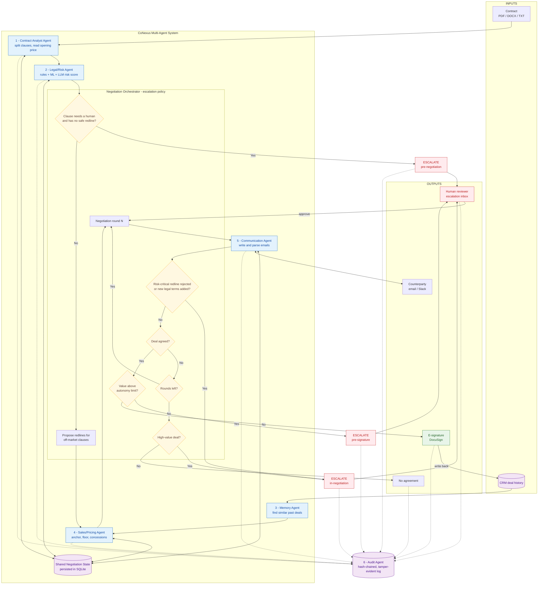
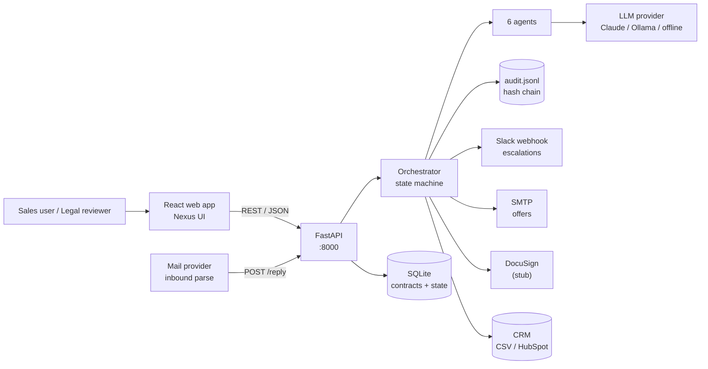
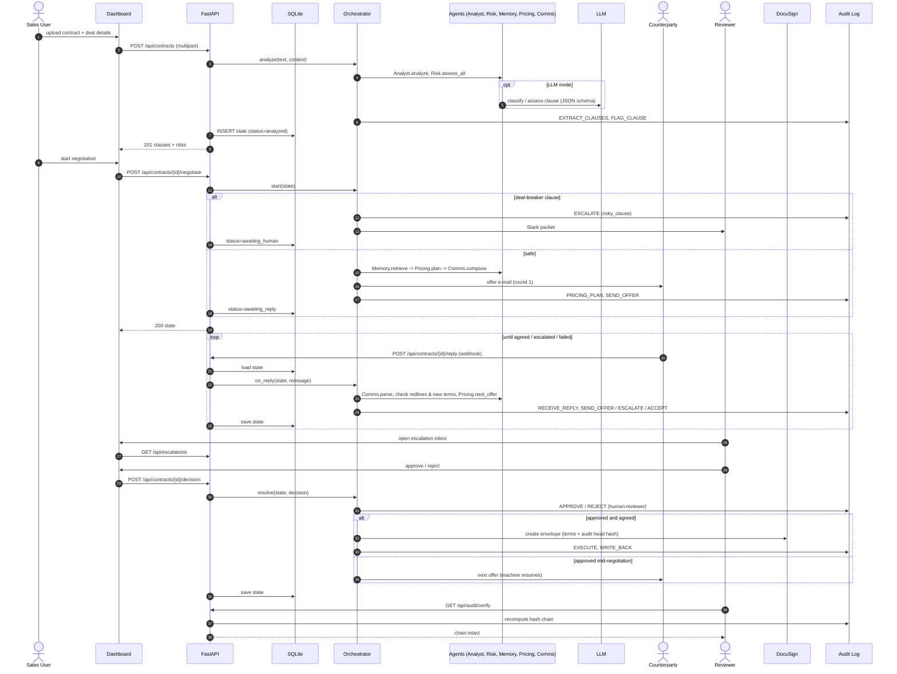
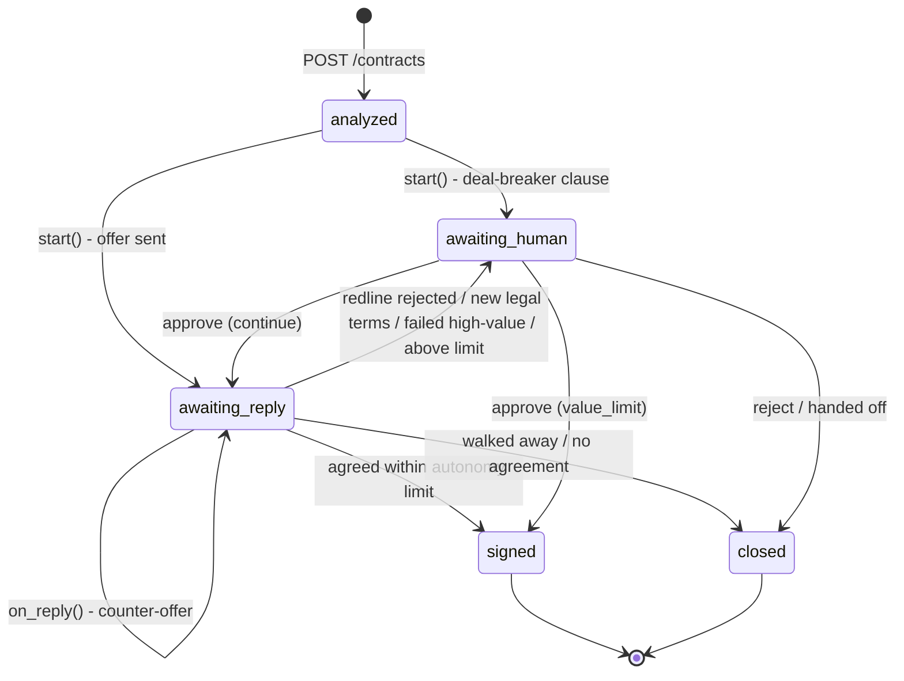

# CoNexus Architecture

## 1. System overview

## 2. Deployment view

## 3. Request flow

## 4. Orchestrator state machine

## 5. API reference

| Method | Path | Purpose |
|---|---|---|
| POST | `/api/contracts` | Upload (`file`) or pick `sample_id` + deal context, runs Analyst + Risk |
| GET | `/api/contracts` | List contracts with status |
| GET | `/api/contracts/{id}` | Full negotiation state |
| POST | `/api/contracts/{id}/negotiate` | Start: `{"mode": "simulated"\|"email", persona, wtp, delay_s}` |
| POST | `/api/contracts/{id}/reply` | Inbound counterparty reply (e-mail webhook) |
| POST | `/api/contracts/{id}/decision` | Human decision `{"approve": bool, "reviewer", "note"}` |
| GET | `/api/escalations` | Human review inbox |
| GET | `/api/contracts/{id}/audit` | Decision trail for one contract |
| GET | `/api/audit/verify` | Verify the global hash chain |
| GET | `/api/metrics` | Portfolio KPIs |
| GET | `/api/samples` | Bundled demo contracts and scenarios |
| GET | `/api/eval` | Latest evaluation results |
| GET | `/health` | Liveness + active LLM provider |

Interactive OpenAPI docs: `http://localhost:8000/docs`.

## 6. Escalation kinds

| Kind | Stage | Trigger | Human "approve" means |
|---|---|---|---|
| `risky_clause` | pre-negotiation | clause needs a human and has no autonomous fallback | flagged clauses accepted, negotiation starts |
| `redline_rejected` | in-negotiation | counterparty rejects redline on a risk-critical clause | clause accepted as drafted, negotiation continues |
| `new_legal_terms` | in-negotiation | counterparty introduces new legal obligations | new terms accepted, negotiation continues |
| `no_deal_high_value` | in-negotiation | talks fail on a deal above the high-value threshold | a human takes the deal over |
| `value_limit` | pre-signature | agreed value above the autonomy limit | deal is signed |

"Reject" always closes the deal. All thresholds live in `conexus/config.py` (`EscalationPolicyConfig`).
