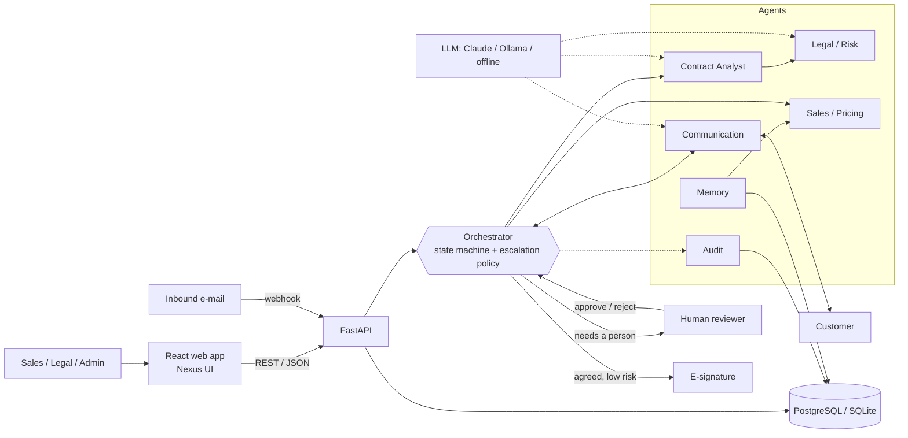
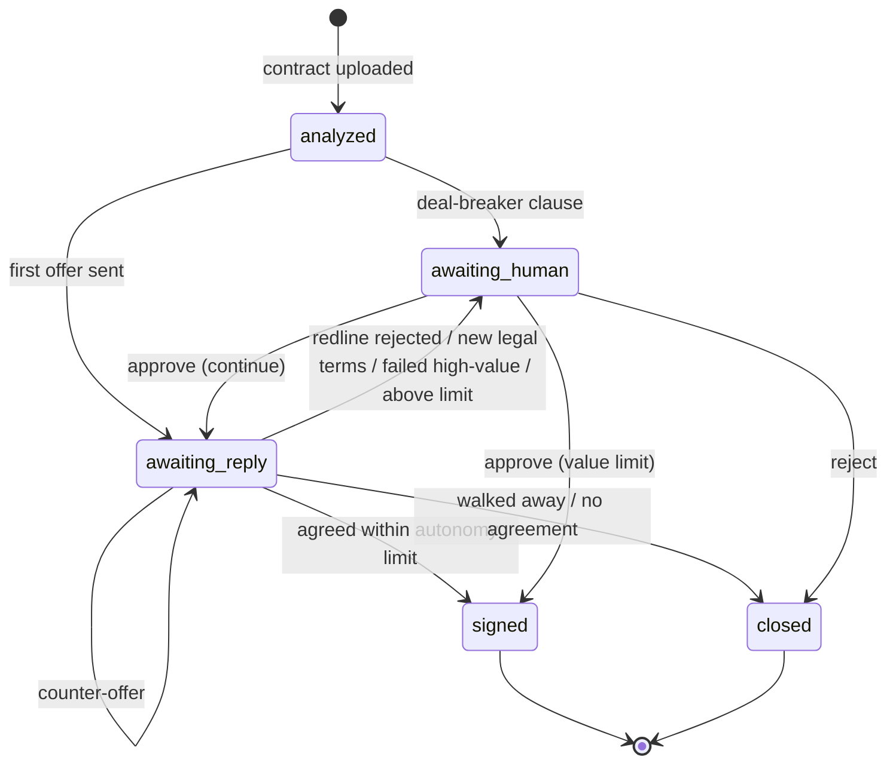
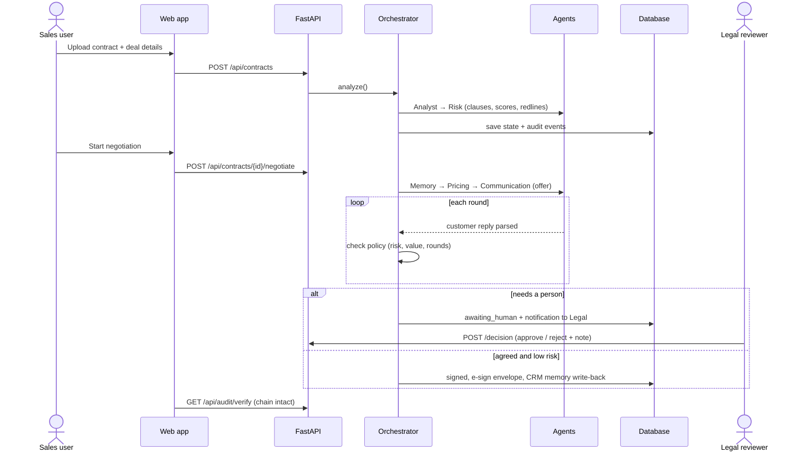

# CoNexus: Project Overview

**A Risk-Aware, Memory-Augmented Multi-Agent Framework for Autonomous B2B Contract Lifecycle Automation**

Live: https://conexus-hdrd.onrender.com · Code: `conexus/` (Python), `frontend/` (React)

---

## 1. What it is

B2B sales teams lose days on every deal. Someone has to read the customer's contract, spot risky
clauses, decide on a price, go back and forth on terms, and get legal to sign off. CoNexus automates
that loop with a team of specialised AI agents:

1. **Reads** the customer's contract (PDF, DOCX or text) and splits it into clauses.
2. **Scores each clause for legal risk** using rules, a model trained on real contracts, and an
   optional LLM.
3. **Prices the deal** from similar past deals in the CRM, which estimate what this buyer will pay.
4. **Negotiates** price, payment terms and redlines with the customer over several rounds.
5. **Signs low-risk deals on its own**, and **pauses for a human** whenever a policy says a person must decide.
6. **Logs every decision** in a tamper-evident, hash-chained audit trail.

The novel part is the combination: autonomy is bounded by an explicit, editable **escalation
policy**, and the pricing is grounded in **memory** of real outcomes rather than a fixed discount table.

---

## 2. Research objectives

| # | Objective | How CoNexus addresses it | Where |
|---|---|---|---|
| RO1 | Multi-agent coordination over shared state | 6 agents + an event-driven Orchestrator over one `NegotiationState` | `conexus/agents/`, `conexus/orchestrator.py` |
| RO2 | Risk-gated escalation | Hybrid risk scoring (hard rules + safe harbours + ML, combined with `max`), 5 escalation kinds | `agents/risk.py`, `orchestrator.py` |
| RO3 | Memory-augmented negotiation | Willingness-to-pay estimate from similar CRM deals sets the anchor and the concession floor | `agents/memory.py`, `agents/pricing.py` |
| RO4 | Audit and explainability | SHA-256 hash-chained append-only log, with a rationale on every decision | `agents/audit.py` |
| RO5 | Empirical evaluation | Real contracts (CUAD), baselines, ablations, LLM experiments, simulated buyers | `conexus/evaluation/` |

---

## 3. System architecture



### The agents

| Agent | Job | Key technique |
|---|---|---|
| **Contract Analyst** | Splits the document into clauses and labels each clause's type | Heading and keyword rules, plus a classifier trained on CUAD (41% → 65% accuracy without headings); LLM fallback |
| **Legal / Risk** | Scores each clause and decides whether it needs a human, then proposes a redline | Hard rules + safe-harbour rules + TF-IDF/logistic regression, combined with `max` |
| **Memory** | Finds the most similar past deals (segment, region, product, seats) | Weighted similarity, top-k = 25 |
| **Sales / Pricing** | Sets the opening ask, the floor and how fast to concede | Willingness-to-pay estimate from won/lost deals, Boulware concession curve, cost-of-capital for payment terms |
| **Communication** | Writes offer e-mails and parses the customer's replies | Templates or LLM for writing; regex first, then LLM for parsing |
| **Audit** | Records every action with its reason | SHA-256 chain: each event stores the previous event's hash |

### Orchestrator state machine



### When a human is asked (escalation kinds)

| Kind | Stage | Trigger | "Approve" means |
|---|---|---|---|
| `risky_clause` | before negotiating | A clause needs a human and has no safe fallback | Clauses accepted, negotiation starts |
| `redline_rejected` | during | Customer rejects a redline on a risk-critical clause | Clause accepted as drafted |
| `new_legal_terms` | during | Customer adds new legal obligations | New terms accepted |
| `no_deal_high_value` | during | Talks fail on a deal above the high-value threshold | A person takes over |
| `value_limit` | before signing | Agreed value is above the autonomy limit | Deal is signed |

"Reject" always closes the deal.

### Policy (editable by Admin in Settings, validated against safe bounds)

| Setting | Default | Meaning |
|---|---|---|
| `clause_threshold` | 0.5 | Risk score at which a clause needs a human |
| `combine` | `max` | Either rules or ML can escalate (`weighted` kept as an ablation) |
| `max_rounds` | 8 | Rounds before the agents stop negotiating |
| `autonomy_value_limit` | $250,000 | Deals above this need human sign-off |
| `escalate_failed_high_value` | $100,000 | Failed deals above this go to a person |
| `max_discount` | 45% | Deepest discount (sets the price floor) |
| `target_payment_days` / `max_payment_days` | 30 / 60 | Opening and longest payment terms |
| `boulware_beta` | 0.5 | Below 1 concedes slowly early |
| `anchor_markup_over_wtp` | 10% | Opening ask above the estimated budget |
| `concession_limit_of_wtp` | 85% | Floor relative to the estimated budget, until the last round |
| `memory_k` | 25 | Similar past deals retrieved |

Every policy change is written to the audit chain with before/after values and the editor's e-mail.

---

## 4. Request flow (one contract, end to end)



---

## 5. Results

### RO2: risk detection on real contracts (CUAD v1)

7,084 lawyer-highlighted clauses from 475 real commercial contracts. The "needs a human" label is a
**proxy** derived from CUAD's deal-breaker categories (Uncapped Liability, IP Ownership Assignment,
Non-Compete, Exclusivity). 5-fold cross-validation grouped by contract, on the 80% development split.

| Approach | Precision | Recall | F1 |
|---|---|---|---|
| Rules only | 0.48 | 0.07 | 0.13 |
| ML trained on synthetic clauses | 0.41 | 0.24 | 0.30 |
| ML trained on CUAD | 0.69 | 0.79 | 0.74 |
| **Hybrid: hard rules + safe harbours + CUAD ML (deployed)** | **0.67** | **0.80** | **0.73** |
| Ablation: hybrid with weighted average instead of `max` | 0.61 | 0.13 | 0.21 |

**Held-out test** (a locked 20% split by contract hash, never used for training or tuning; 1,518
clauses from 99 contracts): rules F1 0.13, CUAD ML 0.75, **hybrid 0.74 (precision 0.65, recall 0.86)**.

Findings:
1. Rules written from a guideline catch only 7% of real deal-breakers. Real training data matters most.
2. How signals are combined decides the result. Averaging lets a quiet rule veto a confident model
   (F1 0.21), while `max` lets either signal escalate (F1 0.73).
3. Rules still add **direction**, which ML cannot learn from CUAD because CUAD does not record which
   party a clause binds. Safe-harbour rules stop "Vendor retains all rights" being flagged like an IP
   transfer, without lowering CUAD recall.

### RO3: memory (synthetic, 180 contracts with a deal zone)

| | Surplus share | Price / buyer budget | Revenue per contract | Agreement | Rounds |
|---|---|---|---|---|---|
| **With memory** | **0.656** | **0.925** | **$47.4k** | 95.6% | 6.5 |
| No memory (cold start) | 0.576 | 0.902 | $44.5k | 97.8% | 5.7 |
| Rule-based baseline | 0.450 | 0.873 | $43.1k | 97.8% | 4.6 |

Memory captures more value per deal, at the cost of slightly more rounds and slightly fewer agreements.

### RO4 / RO5: safety (synthetic, 200 contracts)

- Without the risk gate, **82** human-required clauses get signed unreviewed. With it, **0**, at a
  43% escalation rate.
- Audit logging adds well under 1 ms per contract, and the hash chain verifies.

### Language-model experiments (local Qwen2.5-3B via Ollama)

| Experiment | Result |
|---|---|
| Reply parsing, 46 replies in 6 styles | regex 22% · LLM 39% · regex-first hybrid 41% |
| Risk on 60 held-out CUAD clauses | hybrid without LLM **F1 0.86** · LLM alone 0.64 (flags almost everything) · hybrid + LLM 0.65 |
| Negotiation, 10 contracts | single monolithic LLM: escalated all 10, closed none · CoNexus + LLM messaging: 60% agreed · CoNexus offline: 50% |

A small local model helps with unstructured text, but must not decide escalations on its own. A single
monolithic LLM negotiator does far worse than specialised agents behind a policy gate.

---

## 6. The product (web app)

### Screens

| Screen | Purpose |
|---|---|
| Landing page | Product story, live agent animation, numbers, pricing, "Try the demo" |
| Sign in / Sign up | E-mail sign-up with verification, forgot / reset password, one-click demo |
| Overview | What needs your role, KPIs, pipeline by stage, decisions waiting |
| Contracts | All contracts, filter by stage, search |
| New contract | Drag-and-drop upload with an animated analysis reveal, or a sample contract |
| Contract | Live negotiation thread, price ruler and chart, clause risks with redlines, marked-up document view, memory evidence, audit trail, redlined `.docx` export |
| Escalation inbox | Approve / reject paused deals with a note |
| Analytics | Activity per day, signed value, why deals paused, rounds to agreement, segments, biggest discounts |
| Audit ledger | Hash-chain verification and every decision |
| Notifications | Bell with unread count and toasts for escalations, signed, approved and closed deals |
| Settings | Escalation and pricing policy (Admin), team management, change history, themes |
| Annotate | Expert labelling of real CUAD clauses (Legal) |
| Evaluation / Architecture | Research results and diagrams inside the app |
| Component library | Every Nexus UI component and token |

### Roles

| Role | Can |
|---|---|
| Sales | Create contracts, start negotiations, record replies, export redlines |
| Legal | Everything Sales can, plus approve / reject escalations and label clauses |
| Admin | Everything Legal can, plus edit policy and manage the team |

### Nexus UI

The web app is built from the project's own component library (`frontend/src/ui`):
- design tokens with an Ocean palette, light by default, plus a dark mode and a theme picker;
- about 30 components, including contract-specific ones such as `ClauseCard`, `RedlineDiff`,
  `NegotiationThread`, `PriceChart`, `AuditTimeline`, `DealStepper`, `DocumentView`, `AgentNetwork`
  and `NotificationBell`.

---

## 7. Technology

| Layer | Stack |
|---|---|
| Backend | Python 3.12, FastAPI, Pydantic v2, scikit-learn, NumPy |
| Database | PostgreSQL via psycopg 3 (Neon in production) or SQLite locally, behind one adapter |
| LLM | Offline deterministic fallbacks (default), Anthropic Claude (`claude-opus-5-5`, structured outputs), Ollama (local models) |
| Frontend | React 18, TypeScript, Vite, React Router, Recharts, Lucide, Mermaid |
| Documents | PDF / DOCX parsing; Word tracked-change redlines (`w:ins` / `w:del` + comments) |
| Security | PBKDF2-SHA256 passwords (310k iterations), HttpOnly SameSite session cookies (only the token's SHA-256 is stored), role checks on every endpoint, webhook shared secret |
| E-mail | SMTP for verification and reset links, offers and escalations; Slack webhook for escalations |
| Infra | Docker multi-stage build, Render blueprint (`render.yaml`), GitHub Actions CI (Python tests, web typecheck and build, Docker build) |
| Tests | 39 Python tests, including an end-to-end run on a real PostgreSQL that checks data survives a restart |

### What is stored in the database

Contracts and their negotiation state, users, sessions, e-mail tokens, policy and its history, clause
annotations, the audit hash chain, notifications and read receipts, learned CRM memory, and e-sign
envelopes. With `DATABASE_URL` set, nothing is lost on redeploys.

---

## 8. API (summary)

| Area | Endpoints |
|---|---|
| Health | `GET /health` |
| Auth | `GET /api/auth/status`, `POST /api/auth/{setup, signup, verify, resend-verification, forgot, reset, demo, login, logout}` |
| Team | `GET/POST /api/users`, `PATCH /api/users/{id}` (Admin) |
| Policy | `GET/PUT /api/policy`, `GET /api/policy/history` |
| Contracts | `POST/GET /api/contracts`, `GET /api/contracts/{id}`, `POST .../negotiate`, `POST .../reply` (session or webhook token), `POST .../decision` (Legal), `GET .../document`, `GET .../redline.docx`, `GET .../envelopes`, `GET .../audit` |
| Review | `GET /api/escalations`, `GET /api/audit`, `GET /api/audit/verify` |
| Insights | `GET /api/metrics`, `GET /api/analytics`, `GET /api/eval` |
| Notifications | `GET /api/notifications`, `POST /api/notifications/read` |
| Annotation | `GET /api/annotate/next`, `POST /api/annotate`, `GET /api/annotate/stats` |
| Data | `GET /api/samples`, `GET /api/personas`, `GET /api/outbox` |

Interactive docs at `/docs` on a running server.

---

## 9. Project layout

```
conexus/
  agents/          analyst, risk, memory, pricing, communication, audit
  orchestrator.py  event-driven state machine + escalation policy
  api/             FastAPI server and auth (also serves the built web app)
  store.py         database adapter (PostgreSQL or SQLite)
  llm.py           Claude / Ollama / offline
  sim/             market model + simulated customers
  evaluation/      RO2-RO5 evaluation, CUAD and LLM experiments, baselines
  integrations/    CRM, Slack, SMTP mailer, e-signature, redline .docx
  datasets/        CUAD loader with a locked train/test split
  data_gen/        synthetic clause bank and contract generator
frontend/          React web app; src/ui = Nexus UI component library
docs/              architecture, UI library, annotation guidelines, this file
data/              generated contracts, labels, CRM history
results/           evaluation outputs (JSON)
tests/             unit, API and PostgreSQL tests
```

---

## 10. Running it

```bash
make setup        # Python venv + deps, web deps
make web-build    # build the web app
make api          # http://localhost:8000 (app) and /docs (API)
make test         # Python tests + web typecheck
```

Or `docker compose up --build`. On first start the app asks you to create the first admin; there are
no default passwords.

Main environment variables (see `.env.example`):

| Variable | Purpose |
|---|---|
| `DATABASE_URL` | PostgreSQL URL; empty = local SQLite |
| `CONEXUS_LLM` | `offline` / `anthropic` / `ollama` |
| `CONEXUS_ADMIN_EMAIL`, `CONEXUS_ADMIN_PASSWORD` | Seed the first admin on a fresh deploy |
| `CONEXUS_DEMO`, `CONEXUS_SIGNUP` | One-click demo and e-mail sign-up on/off |
| `CONEXUS_PUBLIC_URL`, `SMTP_*` | Links and sending for verification / reset e-mails |
| `CONEXUS_WEBHOOK_TOKEN` | Secret for inbound e-mail replies |

---

## 11. Limitations

- **Proxy labels on CUAD.** The text is real, but the "needs a human" label is derived from CUAD
  categories, which ignore which party a clause binds. The Annotate page exists to replace them with
  expert labels.
- **Synthetic negotiation data.** Negotiation contracts, CRM history and customers are generated, and
  the safe-harbour rules were written after seeing synthetic false positives, so the synthetic risk
  scores are optimistic.
- **Simulated customers** are parametric. A small human study would strengthen RO3.
- **Time-to-close** in the evaluation comes from a parametric model, not measurements.
- **DocuSign is a stub.** Envelopes are stored in the database but not sent.
- **LLM experiments** used a small local model (Qwen2.5-3B, n = 10 negotiations). Claude is wired in
  but not yet evaluated on the same harness.

## 12. Next steps

1. Expert labels for 100–150 clauses (two annotators, Cohen's kappa), then rerun RO2.
2. Run the LLM experiments with Claude on the same harness.
3. Real DocuSign (JWT grant) and a HubSpot CRM adapter.
4. Paper / report: tables, threshold precision-recall curve, ablations and limitations.

## Data credits

CUAD v1 by The Atticus Project, CC BY 4.0 (Hendrycks et al., *CUAD: An Expert-Annotated NLP Dataset
for Legal Contract Review*, NeurIPS 2021). Downloaded with `conexus fetch-cuad`; raw files are not committed.
