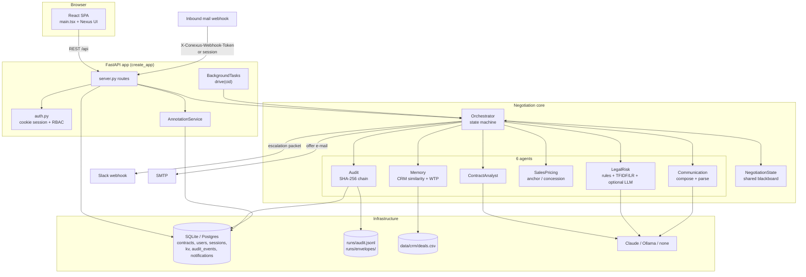
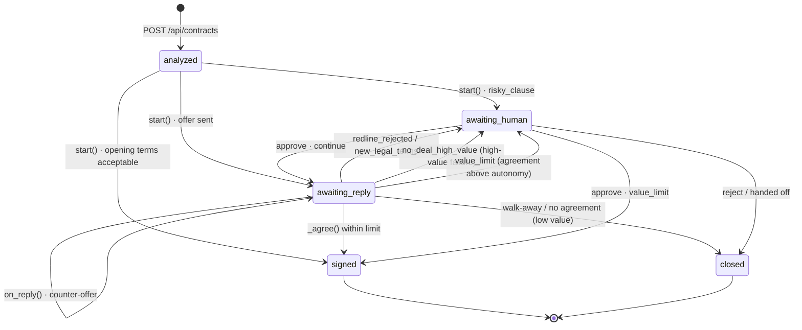
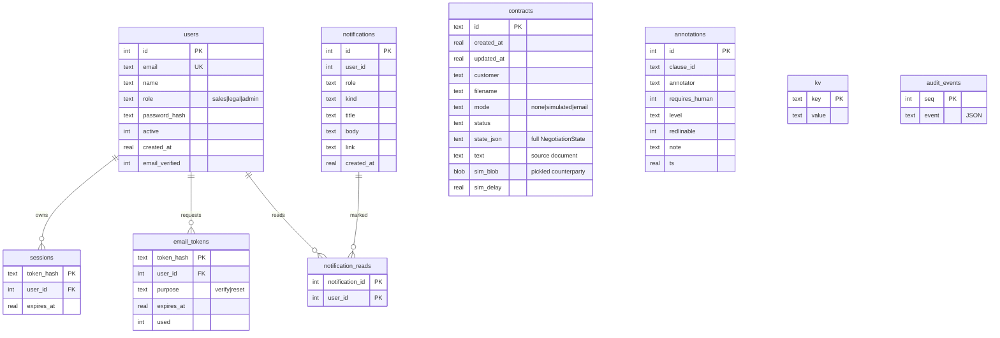

# CoNexus — Full Codebase Analysis

**Repository:** `D:\conexus\conexus` · branch `yash` @ `db8b4ed` (merge of PR #2) · remote `Taniyasumbul/conexus`
**Analysis mode:** read-only source analysis. This file is the only artifact created.
**Method:** direct source reading plus `git` inventory, line-level cross-checks, and the committed test/eval artifacts. The CodeGraph MCP could not be used (no `.codegraph/` index exists anywhere above the repo, and indexing is your decision), so findings come from Read/Grep/Glob and targeted greps.
**Not verified at runtime:** there is no project `.venv` and the global Python lacks `scikit-learn`, so the app was not booted and pytest was not run. Runtime statements below are grounded in code paths, tests, and `results/*.json`, not an execution.

---

## 1. Executive summary

CoNexus is a **single-tenant, offline-first B2B contract-negotiation prototype** wrapped in a research harness. A FastAPI backend runs a deterministic state machine (`Orchestrator`) over a shared Pydantic blackboard (`NegotiationState`), coordinating six agents (Analyst, Legal/Risk, Memory, Sales/Pricing, Communication, Audit). A React 18 SPA ("Nexus UI") exposes the negotiation as a product: upload a contract, watch rounds, approve escalations, inspect the audit hash chain.

What is genuinely strong:

- The **state machine is real and complete**: `analyzed → awaiting_reply | awaiting_human → signed | closed`, with five escalation kinds and explicit human-resolution semantics (`conexus/orchestrator.py:1-12, 121-228`).
- **Offline determinism is real, not a slogan**: every agent has a fallback, and the whole evaluation runs with `llm=None` (`conexus/llm.py:1-8`, `conexus/agents/communication.py:43-52`).
- **Audit chain is a real SHA-256 linked list** with tamper detection, and it is persisted either to `runs/audit.jsonl` or the `audit_events` table (`conexus/agents/audit.py:20-60`).
- **Auth is competently done for a prototype**: PBKDF2-HMAC-SHA256 at 310k iterations, only token hashes stored, HttpOnly SameSite=Lax cookie, role hierarchy (`conexus/api/auth.py:28-101`).
- **Tests are behavioural, not smoke tests**: 38 Python tests covering RBAC, first-run setup, webhook auth, HITL approve/reject, DOCX tracked changes, tamper detection, and Postgres restart persistence.

What a mentor will immediately push on:

- **A confirmed, severe parsing bug**: the inbound regex treats the bare word "deal" as acceptance, and acceptance is evaluated *before* walk-away. "We are no longer interested in this deal" signs the contract (`conexus/agents/communication.py:116, 82-83`; `conexus/orchestrator.py:195-198`).
- **Email mode is not actually deliverable to a counterparty**: the frontend collects `counterparty_email`, the API model accepts it, and nothing consumes it; outbound mail is addressed to `ctx.customer` (a company name) (`frontend/src/pages/ContractDetail.tsx:168`, `conexus/api/server.py:57`, `conexus/orchestrator.py:154`, `conexus/integrations/channels.py:52-59`).
- **CRM "write-back" is in-memory only**, despite the README saying CSV (`conexus/integrations/crm.py:33-35`, `README.md:230`).
- **Research caveats are under-stated**: `results/eval_cuad.json` records `expert_labelled: 0`, and `results/eval_llm.json` contains a `parsing_hybrid_note` admitting the hybrid parser was designed *after* seeing the first run on the same 46 messages.
- **Operational sharp edges**: CORS `*`, no rate limiting, unbounded uploads, per-process locks, no migration framework, and a public demo account with Legal privileges that sees all data.

Overall: a **strong research/prototype codebase (7/10)** and a **weak production deployment (4/10)**. The gap is concentrated in inbound-message correctness, outbound email plumbing, and multi-user/multi-process hardening — all tractable first contributions.

---

## 2. What the project is

CoNexus is framed as a framework for "risk-aware, memory-augmented multi-agent B2B contract lifecycle automation" (`pyproject.toml:3`) and maps itself to five research objectives (`README.md:34-38`):

| RO | Claim | Where it actually lives |
|---|---|---|
| RO1 | Multi-agent coordination over shared state | `conexus/orchestrator.py`, `conexus/models.py` (`NegotiationState`) |
| RO2 | Risk-gated escalation | `conexus/agents/risk.py`, `conexus/evaluation/escalation_eval.py`, `cuad_eval.py` |
| RO3 | Memory-augmented negotiation | `conexus/agents/memory.py`, `pricing.py`, `evaluation/negotiation_eval.py` |
| RO4 | Audit & explainability | `conexus/agents/audit.py` |
| RO5 | Baselines / ablations | `conexus/evaluation/baselines.py`, `negotiation_eval.py` |

The product surface is a **single-company internal tool**: every signed-in user sees every contract; there is no tenant, workspace, or owner column (`conexus/store.py:28-40`, `conexus/api/server.py:512-528`). That is a valid design for an in-house legal/sales tool, but it must be stated explicitly in any deployment discussion.

---

## 3. Tech stack (verified usage)

| Layer | Choice | Evidence / notes |
|---|---|---|
| Language | Python ≥3.11 | `pyproject.toml:6`; CI and Makefile use 3.12; Docker `python:3.12-slim` |
| API | FastAPI + Uvicorn | `conexus/api/server.py:30, 195-197, 801-805` |
| Validation | Pydantic v2 | `conexus/models.py`, `config.py`; `model_dump(mode="json")` |
| ML | scikit-learn TF-IDF + LogisticRegression | `conexus/agents/risk.py:92-115` |
| Numerics | numpy | `conexus/agents/memory.py:6, 58-64` |
| Documents | pypdf, python-docx | `conexus/parsing.py:8-27`, `conexus/integrations/redline_docx.py` |
| LLM | Anthropic SDK / Ollama HTTP / none | `conexus/llm.py:56-137`; provider selected by `CONEXUS_LLM` |
| DB | SQLite default; PostgreSQL via `DATABASE_URL` | `conexus/store.py:99-127, 176-184` |
| CLI | Typer + Rich | `conexus/cli.py` |
| Frontend | React 18.3.1, TypeScript 5.6.2, Vite 5.4.8 | `frontend/package.json` |
| Routing / charts | react-router-dom 6.26.2, Recharts 2.12.7 | `frontend/src/main.tsx`, `frontend/src/ui/charts/index.tsx` |
| Diagrams | Mermaid 10.9.1 | `frontend/src/pages/Architecture.tsx` |
| Icons / fonts | lucide-react, Fontsource Inter / Plus Jakarta / JetBrains Mono | `frontend/src/ui/index.ts:2-9` |
| Tests | pytest (+ FastAPI TestClient) | `tests/`; dev extra only `pytest>=8` |
| CI/CD | GitHub Actions, Docker, Render blueprint | `.github/workflows/ci.yml`, `Dockerfile`, `render.yaml` |

**Declared but unused (verified):**

- `httpx>=0.27` — no direct import anywhere; FastAPI's TestClient brings its own.
- `@fontsource/space-grotesk` — never imported; `frontend/src/ui/index.ts` imports the other three families only.
- `Settings.home_jurisdictions` — defined at `conexus/config.py:71`, referenced nowhere.
- `counterparty_email` — accepted at `conexus/api/server.py:57`, sent by the UI, never read.

---

## 4. Repository layout

```
conexus/                  Python package
  agents/                 analyst, risk, memory, pricing, communication, audit
  api/                    server.py (all routes), auth.py, annotation.py
  data_gen/               synthetic contract + CRM generation
  datasets/               CUAD loader/split
  evaluation/             RO2–RO5 evaluations and baselines
  integrations/           channels.py, crm.py, mailer.py, redline_docx.py
  sim/                    RuleCounterparty, LLMCounterparty, world
  orchestrator.py         state machine + escalation policy
  store.py                SQLite/Postgres persistence
  models.py               shared Pydantic domain model
  llm.py                  Anthropic / Ollama / offline
  parsing.py              PDF/DOCX/TXT → text → sections
  config.py               settings + env loading
  cli.py                  Typer commands
frontend/                 React + TS + Vite SPA
  src/lib/                typed API client, auth provider, hooks
  src/pages/              13 product/research pages
  src/ui/                 Nexus UI component library + tokens
data/                     200 synthetic contracts, 1500 CRM deals, 312 labels, 8055 CUAD clauses
results/                  committed evaluation JSON
runs/                     runtime DB, audit log, envelopes (gitignored)
tests/                    38 Python tests
docs/                     ARCHITECTURE.md, UI_LIBRARY.md, ANNOTATION_GUIDELINES.md
```

Sizes measured: `data/contracts` = 200 `.txt`; `data/crm/deals.csv` = 1501 lines (header + 1500); `data/labels/clauses.jsonl` = 312; `data/labels/contracts.jsonl` = 200; `data/cuad/clauses.jsonl` = 8055.

**File reference table**

| File | Responsibility |
|---|---|
| `conexus/api/server.py` | Composition root, 40 routes, demo seeding, notifications wrapper, analytics |
| `conexus/api/auth.py` | Hashing, sessions, `current_user`, `require()` RBAC |
| `conexus/api/annotation.py` | Stratified CUAD queue, overlap-first, kappa, export |
| `conexus/orchestrator.py` | `analyze/start/on_reply/resolve/_agree/_sign/_fail/drive/run` |
| `conexus/store.py` | Portable schema, CRUD, audit sink, notifications, one migration |
| `conexus/models.py` | `NegotiationState`, `Clause`, `ClauseRisk`, `Terms`, `Outcome`, escalations |
| `conexus/agents/risk.py` | 16-rule playbook, safe harbours, TF-IDF+LR, hybrid combination |
| `conexus/agents/communication.py` | Compose offers, regex/LLM hybrid parse, grounding |
| `conexus/agents/memory.py` | Similarity ranking + WTP ratio estimate from CRM |
| `conexus/agents/pricing.py` | Anchor/floor/limit plan + Boulware concession |
| `conexus/agents/audit.py` | SHA-256 chain, verify, file or DB sink |
| `conexus/integrations/crm.py` | CSV load; **in-memory** `record()` |
| `conexus/integrations/channels.py` | Console/Slack/SMTP + e-sign stub |
| `frontend/src/main.tsx` | Route table + auth gate + polling toasts |
| `frontend/src/lib/api.ts` | Typed client mirroring `models.py` |
| `frontend/src/ui/AppShell.tsx` | Nav, role filtering, theme |
| `docs/ARCHITECTURE.md` | Diagrams + API table (partly stale) |

---

## 5. System architecture



**Layering:** transport (`server.py`) → application services (`auth`, `annotation`, `store`) → core (`orchestrator` + agents) → adapters (`integrations`, `llm`). There is no service layer between routes and orchestrator; routes mutate config and call domain methods directly.

**Two orchestrators, one shared memory.** `create_app` builds `sim_orch` (console channel) and `email_orch` (SMTP), sharing `crm`, `audit`, `classifier`, and `out_dir` (`conexus/api/server.py:188-193`). This is why in-process CRM write-back is visible to both modes. `orch_for()` dispatches on the stored `mode` column (`server.py:200-202`).

**Startup cost:** `RiskClassifier.default()` reads 312 synthetic labels plus every non-test CUAD clause and fits TF-IDF + logistic regression at app construction (`risk.py:122-150`). With the committed data that is ~5–7k texts; expect a noticeable cold start. There is no caching to disk, so every process fits its own model.

**Design pattern:** blackboard + explicit state machine. Agents are pure-ish functions over state; the orchestrator is the only writer of lifecycle fields. This makes the system easy to test and reason about — the strongest architectural decision in the repo.

---

## 6. Execution flows

### 6.1 Upload → analysis

1. `POST /api/contracts` validates file suffix or `sample_id` (`server.py:480-501`).
2. File bytes are read fully into a `NamedTemporaryFile`, then `read_document()` extracts text (`server.py:495-500`, `parsing.py:8-27`).
3. `sim_orch.analyze()` runs the Analyst then the Risk agent and appends audit events (`orchestrator.py:95-107`).
4. State is stored as JSON with status `analyzed` (`server.py:507-510`, `store.py:195-198`).

No size limit is enforced; the entire upload is held in memory.

### 6.2 Simulated negotiation

`POST /negotiate` → create a `RuleCounterparty` → `store.save(..., mode="simulated", sim_delay)` → `sim_orch.start(st)` → `store.save` → queue `drive(cid)` as a FastAPI background task (`server.py:534-552`).

`drive()` holds a per-contract `threading.Lock`, sleeps `sim_delay` between rounds, asks the simulated buyer for a reply, and calls `on_reply` until the status leaves `awaiting_reply` (`server.py:215-225`). The counterparty is **pickled into the DB** so its private RNG/reservation state survives a restart (`store.py:8-11, 202-204, 220-222`).

**Operational consequence:** because the lock is held across `time.sleep`, and `delay_s` can be 30 s with up to 8 rounds (`config.py:38`, `server.py:56`), demo settings can block every other request for that contract for minutes. The UI's own `GET /contracts/{id}` will wait. This is intentional for live demos but wrong for production.

### 6.3 Email mode

`start()` composes round 1 and sends through `EmailChannel` (`orchestrator.py:152-169`). Inbound replies arrive at `POST /api/contracts/{cid}/reply`, authenticated either by `X-Conexus-Webhook-Token` (constant-time compare) or a Sales session (`server.py:554-570`). Only email-mode contracts accept replies (409 otherwise).

The UI collects a counterparty email, but the backend ignores it and addresses mail to `ctx.customer` (`orchestrator.py:154`, `channels.py:52-59`). With SMTP configured, a customer name like "Acme Corp" is an invalid `To:` header; without SMTP, nothing leaves the machine. **Email mode is effectively a local transcript mode today.**

### 6.4 Human-in-the-loop

Escalation sets `status="awaiting_human"`, stores an `EscalationDecision`, writes an `Outcome(status="escalated")`, and sends a packet to Slack/console (`orchestrator.py:73-92`).

`POST /decision` (Legal+) calls `resolve()` (`server.py:572-584`):

| Kind | On approve | On reject |
|---|---|---|
| `risky_clause` | mark all `requires_human` clauses reviewed, `start()` | `closed` / `rejected_by_human` |
| `redline_rejected` | mark rejected clauses reviewed, `_next_turn()` | same |
| `new_legal_terms` | `_next_turn()` | same |
| `value_limit` | `_sign(agreed_terms)` | same |
| `no_deal_high_value` | `closed` / `handed_off` | same |

`resolve()` refuses if the contract is not `awaiting_human` or has no escalation (`orchestrator.py:201-204`), and the route maps that to 409. Reviewer identity comes from the session, not the request body (`server.py:574`).

**Re-checked claim:** the earlier suspicion that approving a `risky_clause` duplicates the round-0 history entry is **not true**: `start()` returns at the gate *before* appending history (`orchestrator.py:121-141`), so the first call appends nothing and the post-approval call appends exactly once.

### 6.5 Signing

`_agree()` applies the autonomy-value check (`price × term_years > limit` → `value_limit` escalation), otherwise `_sign()` builds an e-sign envelope containing terms, accepted redlines, reviewed clauses, and the audit head (`orchestrator.py:231-258`). `ESignStub` writes JSON to `runs/envelopes/` (`channels.py:62-70`). On success, `learn=True` writes a `DealRecord` into the in-memory CRM list (`orchestrator.py:252-257`; `server.py:188`).

### 6.6 State machine



Note: the docs' `awaiting_human → awaiting_reply` edge is typical but not guaranteed; `risky_clause` approval calls `start()`, which can go straight to `signed` if the opening terms are already acceptable (`orchestrator.py:214-216 → 138-159`).

---

## 7. Data model and persistence



Key facts:

- **`contracts` is the aggregate root.** The full `NegotiationState` is a JSON string; querying by status/customer uses denormalized columns. There are no per-clause rows — clauses exist only inside JSON.
- **Portable schema** uses `{ID}/{BLOB}/{TS}` substitution: SQLite `INTEGER PRIMARY KEY AUTOINCREMENT / BLOB / REAL`, Postgres `BIGSERIAL / BYTEA / DOUBLE PRECISION` (`store.py:25-102`). This keeps the SQL single-sourced.
- **Migrations:** exactly one, the `email_verified` column add (`store.py:183-184`). No Alembic, no version table. Adding a column in the future requires hand-written `ALTER` logic.
- **Postgres reconnect:** a single retry on connection errors, with `autocommit=True` (`store.py:120, 129-142`). Not a pool, not concurrency-safe under threads — `psycopg` connections are not guaranteed thread-safe, while FastAPI sync endpoints run in a threadpool. The `Store.lock` serializes access within a process, which mitigates but also serializes all DB work.
- **Notification reads** are a join table keyed by `(notification_id, user_id)`; role-addressed notifications use `role` instead of `user_id` (`store.py:315-330`).
- **Audit sink choice** is binary: Postgres → `audit_events`; otherwise `runs/audit.jsonl` (`server.py:184`). SQLite deployments keep the audit chain on disk while business data is also on disk, so both are lost together.
- **Pickle** of the simulated counterparty is a trust boundary: the docstring says only self-pickled objects are stored, which is true, but any DB writer can inject code executed on `sim()`. Fine for a prototype, unacceptable if the DB is shared.

---

## 8. API surface

40 routes total (39 under `/api`, plus `/health` and the SPA catch-all). Auth column shows the minimum role.

| Method | Path | Auth | Purpose |
|---|---|---|---|
| GET | `/health` | public | liveness + LLM name (`server.py:287-289`) |
| GET | `/api/auth/status` | public | setup flag, current user, demo/signup flags |
| POST | `/api/auth/setup` | public* | one-time first admin (`*only while no real users`) |
| POST | `/api/auth/signup` | public | Sales self-signup, email verification |
| POST | `/api/auth/verify` | public | consume verify token, sign in |
| POST | `/api/auth/resend-verification` | public | resend, no enumeration |
| POST | `/api/auth/forgot` | public | reset link, no enumeration |
| POST | `/api/auth/reset` | public | consume reset token, sign in |
| POST | `/api/auth/demo` | public* | one-click Legal demo (`*CONEXUS_DEMO`) |
| POST | `/api/auth/login` | public | password login |
| POST | `/api/auth/logout` | session | delete session + cookie |
| GET | `/api/users` | admin | list team |
| POST | `/api/users` | admin | create user |
| PATCH | `/api/users/{uid}` | admin | role/active/password; self-lockout guard |
| GET | `/api/policy` | sales | current policy + UI schema |
| PUT | `/api/policy` | admin | validated, applied live, audited |
| GET | `/api/policy/history` | sales | last 50 POLICY_CHANGE events |
| POST | `/api/contracts` | sales | upload/sample → analyze |
| GET | `/api/contracts` | sales | list summaries |
| GET | `/api/contracts/{cid}` | sales | full state |
| POST | `/api/contracts/{cid}/negotiate` | sales | start simulated/email |
| POST | `/api/contracts/{cid}/reply` | webhook token **or** sales | inbound counterparty reply |
| POST | `/api/contracts/{cid}/decision` | legal | approve/reject escalation |
| GET | `/api/contracts/{cid}/document` | sales | text + clause offsets |
| GET | `/api/contracts/{cid}/redline.docx` | sales | tracked-changes DOCX |
| GET | `/api/escalations` | sales | human inbox |
| GET | `/api/contracts/{cid}/audit` | sales | per-contract events |
| GET | `/api/audit` | sales | recent events (`limit=200`) |
| GET | `/api/audit/verify` | sales | recompute chain |
| GET | `/api/metrics` | sales | portfolio KPIs |
| GET | `/api/samples` | sales | bundled contracts + scenarios |
| GET | `/api/personas` | sales | buyer personas |
| GET | `/api/eval` | sales | committed eval JSON |
| GET | `/api/annotate/next` | legal | next clause (no anchoring) |
| POST | `/api/annotate` | legal | submit label |
| GET | `/api/annotate/stats` | legal | kappa, coverage, export path |
| GET | `/api/notifications` | sales | role-addressed feed |
| POST | `/api/notifications/read` | sales | mark ids/all |
| GET | `/api/analytics` | sales | 14-day series + portfolio cuts |
| GET | `/api/outbox` | sales | recorded escalation messages |
| GET | `/{path:path}` | public | SPA fallback, blocks `api/`, `docs`, `openapi.json` |

Error semantics are consistent: 404 unknown contract, 409 wrong-state/duplicate start, 415 unsupported suffix, 422 Pydantic validation (`server.py:484-506, 536-539, 563-568`).

**API-level observations:**

- `limit` on `/api/audit` and `/api/samples` is unvalidated; a negative value does surprising slicing.
- `/api/contracts` and `/api/analytics` load and parse **every** contract on every request. Fine at 200 rows, quadratic pain at 20k.
- The SPA fallback is safe: it resolves the path and checks `dist in f.parents` before serving a file (`server.py:789-796`).

---

## 9. Agents and business logic

### 9.1 Agent contracts

| Agent | Input | Algorithm | Output |
|---|---|---|---|
| `ContractAnalystAgent` | raw text | section split; heading hints; keyword scoring; LLM only for low confidence; regex price/net-days | `clauses[]`, `opening_terms` (`analyst.py:14-67`) |
| `LegalRiskAgent` | `Clause[]` | 16 regex rules + TF-IDF/LR + optional LLM; safe harbours; max/weighted combine | `ClauseRisk[]` with score, level, `requires_human`, redline (`risk.py:39-229`) |
| `MemoryAgent` | `DealContext` | weighted similarity: segment 2.0, region 1.5, product 1.0, log-seat 1.0; weighted p80 won / p20 lost → WTP ratio | top-k deals + WTP estimate (`memory.py:19-64`) |
| `SalesPricingAgent` | plan + round | anchor above WTP, floor at `list×(1-max_discount)`, Boulware `f=(r/(max-1))^(1/β)`, clamp to their last offer | `PricingPlan`, `Terms` (`pricing.py:26-63`) |
| `CommunicationAgent` | terms / reply | template facts; optional LLM prose; regex + LLM hybrid parse with grounding | `str` / `Offer` (`communication.py:33-119`) |
| `AuditAgent` | event | SHA-256 over canonical JSON incl. `prev_hash`; verify recomputes | append-only chain (`audit.py:20-60`) |

### 9.2 Risk policy (the core IP)

Rules are typed, hard/soft, redlinable, and carry a human-readable reason (`risk.py:24-56`). Hard rules force `requires_human=True` regardless of score. Non-hard levels map to low scores (0.05/0.3/0.45) so they cannot escalate alone (`risk.py:83`).

Combination modes (`risk.py:183-190`):

- `rules`: rule score only.
- `ml`: ML probability only, hard flag dropped.
- `hybrid` + `combine="max"` (default): `max(rule_score, ml)` — either signal escalates.
- `hybrid` + `combine="weighted"`: `(1-w)·rule + w·ml`.

Safe harbours cap the score at 0.3 when the wording favours the vendor and no hard rule fired (`risk.py:62-70, 214-219`). This is a thoughtful response to CUAD's direction-blind labels.

Escalation if `hard or score >= clause_threshold` (default 0.5) (`risk.py:220`, `config.py:35`).

**Redline eligibility:** `redl and clause.type in REDLINES` (`risk.py:223`). A clause can be "redlinable" per a rule but still lack a redline template, in which case it neither auto-redlines nor (if soft) escalates — it is silently accepted. That is a policy gap worth reviewing.

### 9.3 Escalation taxonomy

| Kind | Stage | Trigger | Approve means |
|---|---|---|---|
| `risky_clause` | pre-negotiation | hard clause, not redlinable, unreviewed | accept clauses, start |
| `redline_rejected` | in-negotiation | rejection on a risk-critical clause | accept as drafted, continue |
| `new_legal_terms` | in-negotiation | counterparty injects exclusivity/indemnity/IP/audit | accept, continue |
| `no_deal_high_value` | in-negotiation | failure above `escalate_failed_high_value` | hand to human |
| `value_limit` | pre-signature | agreed annual value > autonomy limit | sign |

Sources: `orchestrator.py:109-124, 185-198, 231-237, 260-266`, `config.py:32-42`.

### 9.4 Confirmed logic defects

**(a) Critical — "deal" means accept, before walk-away.**

```python
# conexus/agents/communication.py:116
accept=bool(re.search(r"\bwe accept your (proposal|offer)\b|\bdeal\b", low)),
```

and in `on_reply`:

```python
# conexus/orchestrator.py:195-198
if theirs.accept:
    return self._agree(st, st.last_our_offer)
if theirs.walk_away:
    return self._fail(st, "counterparty walked away")
```

Consequences, both verified by control flow:

1. "We are no longer interested in this deal." → `accept=True` (bare `deal`) **and** `walk_away=True`; acceptance is checked first, so the deal is signed at *our* last offer.
2. "We cannot agree to this deal at that price." → signed.
3. Hybrid mode ORs the regex with the LLM (`communication.py:82`), so a correct LLM `accept=False` is overridden by the regex.

This is the highest-priority correctness bug in the repo. Fix: require the acceptance phrase, remove the bare `deal` alternative, and evaluate `walk_away` before `accept`.

**(b) High — email mode cannot address the counterparty.** `counterparty_email` is dead (`server.py:57`), while `outbound.send(ctx.customer, ...)` passes a company name (`orchestrator.py:154`). Either add `counterparty_email` to `NegotiationState`/`DealContext` and use it, or remove the field and label the mode "transcript".

**(c) Medium — CRM write-back is process-local.** `CRMStore.record()` appends to a list (`crm.py:33-35`); nothing writes `deals.csv`. README line 230 claims CSV/memory. After restart, learned deals vanish, and `/api/metrics.crm_memory_size` reports only the seed 1500 + session signings (`server.py:658`).

**(d) Medium — "no deal" outcome loses its terms.** `_fail()` for low-value deals records `outcome` without `final_terms` (`orchestrator.py:263-264`), so analytics cannot attribute lost value. `no_deal_high_value` preserves `their_last` (`orchestrator.py:224-227`), so the two paths are inconsistent.

**(e) Low — notification stage-transition detection is status-only.** `save_and_notify` compares old/new status (`server.py:237-256`). Two escalations while already `awaiting_human` produce no second notification; a changed escalation reason is invisible in the bell.

**(f) Low — `resolve()` for `value_limit` signs `st.agreed_terms` without re-checking it is non-null** (`orchestrator.py:222-223`). The invariant currently holds, but it is implicit.

### 9.5 Pricing sanity check

`value(t) = price × (1 − 0.12 × days/365)` (`pricing.py:22-24`). `acceptable()` rejects below floor or above max days, then requires `value(theirs) ≥ 0.995 × value(our_next)` (`pricing.py:60-63`). Because `our_next` in round 1 is near the anchor, early acceptance is rare by design; the system usually spends rounds conceding. This matches the committed evaluation (avg ~6.45 rounds to agree, `results/eval_negotiation.json`).

---

## 10. Security and access control

### Verified strengths

- **Password storage:** PBKDF2-HMAC-SHA256, 310,000 iterations, 16-byte salt, constant-time compare via `hmac.compare_digest` (`auth.py:31-50`). Password strength policy exists (`auth.py:52-55`).
- **Sessions:** 32-byte random token; only SHA-256 hash stored; DB lookup enforces `expires_at > now` and `active=1` (`auth.py:57-65`, `store.py:289-294`). Cookie is `HttpOnly`, `SameSite=Lax` (`server.py:292-294`).
- **RBAC:** three ordered roles; `require()` is a dependency, so every protected route is explicit (`auth.py:28, 93-101`). Role changes and deactivation delete sessions (`store.py:286-287`).
- **No enumeration:** forgot/resend return the same shape whether or not the account exists (`server.py:371-383`).
- **Webhook auth:** constant-time token comparison; falls back to a Sales session only if the header is absent/invalid (`server.py:558-560`).
- **First-run setup:** disabled once any real user exists; demo account excluded from the "real users" count (`server.py:262-263, 305-314`).
- **Path traversal:** SPA fallback checks `dist in f.parents` (`server.py:793-795`); sample IDs are `Path(...).name`-sanitized (`server.py:487`).
- **Dev link leak guarded:** `dev_link` only returned when SMTP is unconfigured **and** `CONEXUS_DEV_EMAIL_LINKS=1` (`server.py:336-339`; `mailer.py:24-25`).

### Findings (verified unless marked "potential")

| # | Severity | Finding | Evidence | Why it matters |
|---|---|---|---|---|
| S1 | **Critical** | Bare "deal" = acceptance; accept checked before walk-away | `communication.py:116`, `orchestrator.py:195-198` | Signs unagreed/walked-away deals; a legal/financial integrity failure |
| S2 | **High (potential)** | Demo account has Legal role and sees all contracts; one shared account for all visitors | `server.py:397-409`; `render.yaml` sets `CONEXUS_DEMO=1` | On any instance mixing real and demo data, anonymous visitors can read and approve real escalations |
| S3 | **High** | No rate limiting on login/signup/forgot/demo | `server.py:341-419` | Password brute force; email-bomb / SMTP quota abuse |
| S4 | **Medium** | CORS `allow_origins=["*"]` with credentials-by-cookie | `server.py:197` | Browsers block `*` + credentials, so this mostly fails closed, but it signals no origin policy; any future `allow_credentials=True` becomes a hole |
| S5 | **Medium (potential)** | Cookie `secure` inferred from `request.url.scheme`; no explicit proxy trust config | `server.py:294`, `server.py:801-805` | Behind a TLS-terminating proxy, scheme may be `http`, producing a non-Secure session cookie |
| S6 | **Medium** | No upload size cap; full read into memory/temp file | `server.py:492-500` | Trivial memory/disk DoS |
| S7 | **Medium** | No tenant/ownership model | `store.py:28-40` | Every Sales user can read every contract and audit event; acceptable in-house, unsafe as SaaS |
| S8 | **Medium** | Self-signup enabled by default once an admin exists; new accounts are Sales | `server.py:317` (`os.getenv("CONEXUS_SIGNUP", "1")`) | Public instance gets open registration unless env explicitly disables it |
| S9 | **Low** | Existing-but-unverified email can be overwritten (name/password) by anyone | `server.py:349-355` | Pre-verification account takeover (limited impact) |
| S10 | **Low** | No CSRF token; relies on SameSite=Lax | `server.py:293` | State-changing POSTs are protected for cross-site form posts, but not for same-site subdomain attackers |
| S11 | **Low** | Sessions never garbage-collected | `store.py:289-297` | Table growth; expired rows accumulate |
| S12 | **Low** | Pickled counterparty in DB | `store.py:202-204, 220-222` | Code execution if an attacker can write the DB |
| S13 | **Low** | Audit head is not externally anchored | `audit.py:1-7` | A writer who rewrites the whole log+head is undetectable; docs acknowledge anchoring as future work |
| S14 | **Info** | `CONEXUS_DEMO` and `CONEXUS_SIGNUP` default to `1` in `.env.example` | `.env.example` | Copying the example to `.env` enables public demo + signup locally; intentional for dev, surprising on a server |

**Not a vulnerability, but worth knowing:** the `/api/audit` and `/api/contracts` endpoints return all data to any Sales user, including other customers' contract text and negotiated prices. Again, single-tenant assumption.

---

## 11. External integrations

| Integration | Status | Config (names only) | Failure behaviour |
|---|---|---|---|
| Anthropic Claude | Real, optional | `ANTHROPIC_API_KEY`, `CONEXUS_ANTHROPIC_MODEL`, `CONEXUS_EFFORT` | Raises `LLMError`; every caller falls back to deterministic logic |
| Ollama | Real, optional | `CONEXUS_OLLAMA_MODEL`, `OLLAMA_HOST` | 300 s timeout, `LLMError` fallback |
| Slack escalations | Real | `SLACK_WEBHOOK_URL` | No try/except; a webhook failure would propagate into `start()/on_reply()` |
| SMTP (offers + auth mail) | Real | `SMTP_HOST/PORT/USER/PASSWORD/FROM` | `mailer.send` catches and returns `False`; `EmailChannel.send` does **not** catch |
| Inbound mail | Webhook | `CONEXUS_WEBHOOK_TOKEN` | 401/403 without valid token or session |
| CRM | CSV read + in-memory write | `Settings.crm_path` | Missing file → empty store (`crm.py:18-19`); no write-back |
| E-signature | Stub | `runs/envelopes/` | Always succeeds; writes JSON |
| Postgres | Real | `DATABASE_URL` | One reconnect retry (`store.py:129-142`) |
| CUAD download | CLI only | hard-coded GitHub URL | `conexus fetch-cuad` (`cli.py:159-179`) |

**Asymmetry worth flagging:** `SlackChannel.send` and `EmailChannel.send` have no error handling, while `mailer.send` does. An unreachable Slack webhook can turn a routine escalation into a 500 and leave the state machine half-transitioned (the audit event is written before the send at `orchestrator.py:86-87`, so the log says "escalated" while the DB may not).

**DOCX redlining** is a genuine implementation, not a stub: it diffs clause text into insert/delete runs, writes `w:ins`/`w:del` revisions and a margin comment, and stamps the audit head (`redline_docx.py:27-81`). The test asserts tracked-change XML exists (`tests/test_api.py:191-202`).

---

## 12. Evaluation results — and their caveats

All numbers below are from committed `results/*.json`, not recomputed.

### RO2 on CUAD (`results/eval_cuad.json`)

Deployed hybrid, 5-fold CV grouped by contract: **P 0.665 / R 0.797 / F1 0.725**. Held-out locked test (99 contracts, 1,518 clauses): **P 0.647 / R 0.859 / F1 0.738**.

| Approach | P | R | F1 |
|---|---|---|---|
| Rules only | 0.479 | 0.074 | 0.128 |
| ML synthetic | 0.410 | 0.242 | 0.304 |
| ML CUAD CV | 0.692 | 0.791 | 0.739 |
| Hybrid CUAD CV | 0.665 | 0.797 | 0.725 |
| Weighted-average ablation | 0.608 | 0.127 | 0.210 |

The "rules catch 7–8%" and "max beats average" findings are strongly supported by these numbers and are the most publication-ready part of the project.

### Caveats a mentor will ask about

1. **`expert_labelled: 0`** — the ground truth is a *proxy* label derived from four CUAD deal-breaker categories, not lawyer judgments. The annotation tool exists to fix this (`docs/ANNOTATION_GUIDELINES.md`, `conexus/api/annotation.py`), but no expert labels are committed. Frame RO2 as "proxy-label performance", not "legal accuracy".
2. **`parsing_hybrid_note`** in `results/eval_llm.json`: *"post-hoc revision: regex-first, LLM fills gaps; designed after seeing the first run on the same 46 messages."* This is admirably honest but means the hybrid parsing numbers are not a clean held-out result. Either re-run on unseen messages or report it as a case study.
3. **README/result drift:** README says 7,084 clauses / 475 contracts (`README.md:139`); `eval_cuad.json` says 5,566 / 376. Likely different filters or dataset versions. Pick one source of truth.
4. **LLM results are tiny and model-specific:** parsing n=46 with `qwen2.5:3b`; negotiation n=10. Directionally interesting (CoNexus 0.60 agreement vs single-LLM 0.0; 15.3 s vs 1.9 s per contract), not statistically strong.
5. **Self-reported runtime** excludes network/LLM latency: `runtime_ms_per_contract` is agent compute only. State this in the paper.

### RO3/RO5 (`results/eval_negotiation.json`)

| System | Agreement | Escalation | Rounds | Price/WTP | Risky handled | Unreviewed risky signed |
|---|---|---|---|---|---|---|
| CoNexus full | 0.485 | 0.43 | 6.45 | 0.931 | 1.0 | 0 |
| No audit | 0.485 | 0.43 | 6.45 | 0.931 | 1.0 | 0 |
| No memory | 0.515 | 0.415 | 5.64 | 0.908 | 1.0 | 0 |
| No risk gate | 0.86 | 0.0 | 6.51 | 0.925 | 0.159 | 82 |
| Rule-based | 0.88 | 0.0 | 4.64 | 0.873 | 0.145 | 84 |
| Human-only (modelled) | 0.88 | 0.0 | 4.64 | 0.873 | 1.0 | 0 |

The honest story: the risk gate costs agreement rate but eliminates unreviewed risky signings; memory improves price realization but *lowers* agreement rate and raises rounds. The "no audit" ablation being identical is expected (audit is observational), so it is a sanity check rather than a result.

### RO4

`audit_verification: "OK - chain intact"`, 2,980 events in the negotiation eval. Tamper and deletion detection are directly tested (`tests/test_core.py:15-38`).

---

## 13. Testing and CI

**38 Python test functions** (README says 29 — drift):

| File | Count | Coverage |
|---|---|---|
| `tests/test_api.py` | 22 | upload, suffix rejection, full simulation, HITL approve/reject, email webhook, double-start 409, annotation+kappa, auth required, RBAC, first-run setup, admin self-lockout, policy validation/audit, DOCX revisions, webhook token, demo seeding/disabled, document offsets, signup/verify/reset, dev-link guard, signup before admin, notifications, analytics shape |
| `tests/test_core.py` | 7 | audit tamper/deletion, hard-rule escalation, redline-not-escalate, opening-term extraction, strict schema, offline end-to-end |
| `tests/test_llm_paths.py` | 8 | LLM-only-when-unsure, risk LLM/hybrid, fallback on failure, comms parse/compose, regex fallback, nested strict schema, Anthropic request shape, refusal |
| `tests/test_postgres.py` | 1 | full app on real Postgres + restart survival; **skipped unless `pgserver` is installed** |

**CI** (`.github/workflows/ci.yml`): Python 3.12 `pytest -q`; Node 20 `npm ci` + `tsc -b --noEmit` + `vite build`; Docker build gated on both. It does **not** install `pgserver`, so the Postgres test never runs in CI, despite the README's "tested against a real Postgres" claim. That is true only if a developer installs `pgserver` manually (it is not in `[dev]`).

**Gaps:**

- **No frontend tests at all.** No Vitest/Playwright, no `test` script in `package.json`; CI typechecks and builds only.
- **No negative test for the acceptance regex.** The only email acceptance test sends the happy path `"We accept your proposal of $X. Deal."` (`tests/test_api.py:104`), which would pass even with the bug. A walk-away-containing-"deal" test is the single highest-value test to add.
- **No concurrency test** for two workers/processes or simultaneous decide+drive.
- **No upload-size test.**
- **No lint/format config** anywhere: no Ruff, Black, ESLint, Prettier, mypy, or pre-commit. There is one `# noqa` and one `eslint-disable` comment, implying tools were used ad hoc.
- **No coverage measurement.**
- **Test fixtures create a real app per test** and fit the risk classifier each time, so the suite is slower than it needs to be; a session-scoped classifier fixture would help.

---

## 14. Deployment and operations

**Docker:** multi-stage — Node 20 builds `frontend/dist`, Python 3.12 slim installs the package editable, copies `data/` and `results/`, and runs `conexus-api` on port 8000 (`Dockerfile`). The editable install is deliberate so `parents[2]/frontend/dist` resolves (`server.py:782`).

**Compose:** one service, `runs/` volume, optional LLM/Slack env (`docker-compose.yml`).

**Render:** one Docker web service, health check `/health`, demo + signup enabled, `DATABASE_URL` and SMTP entered in the dashboard (`render.yaml`).

**Commands (verbatim from `Makefile` / `pyproject.toml`, not invented):**

```bash
make setup        # uv venv --python 3.12 && uv pip install -e ".[dev]" ; cd frontend && npm install
make test         # .venv/bin/pytest -q ; cd frontend && npx tsc -b --noEmit
make api          # .venv/bin/conexus-api
make web          # cd frontend && npm run dev
make web-build    # cd frontend && npm run build
make data         # .venv/bin/conexus generate-data
make cuad         # .venv/bin/conexus fetch-cuad
make eval         # eval-escalation && eval-cuad && eval-negotiation
make up           # docker compose up --build
make clean        # rm -rf runs/*
```

**Windows note:** the Makefile assumes POSIX (`PY := .venv/bin`, `rm -rf`, `&&` with `cd`). On Windows, run the underlying commands directly:

```powershell
uv venv --python 3.12
uv pip install -e ".[dev]"
cd frontend; npm install
.venv\Scripts\pytest -q
.venv\Scripts\conexus-api
```

There is no PowerShell task runner and no `.venv` checked in.

**Environment variables** (names only; values were not inspected): `CONEXUS_LLM`, `ANTHROPIC_API_KEY`, `CONEXUS_ANTHROPIC_MODEL`, `CONEXUS_EFFORT`, `CONEXUS_OLLAMA_MODEL`, `OLLAMA_HOST`, `SLACK_WEBHOOK_URL`, `SMTP_HOST/PORT/USER/PASSWORD/FROM`, `CONEXUS_ADMIN_EMAIL/PASSWORD`, `CONEXUS_WEBHOOK_TOKEN`, `CONEXUS_DEMO`, `CONEXUS_SIGNUP`, `DATABASE_URL`, `CONEXUS_PUBLIC_URL`, `CONEXUS_DEV_EMAIL_LINKS`, `HOST`, `PORT`.

**Operational limits:**

- **Single process assumed.** In-memory caches (`audit.events`, `crm.deals`, `escalations.sent`, `locks`) are authoritative for parts of the system. Two Uvicorn workers would have divergent audit heads, divergent CRM memories, and independent locks — the audit chain would fork. `render.yaml` runs one process, which is correct today. If you scale, the audit/CRM/locks must move behind the DB or a single writer.
- **SQLite + FastAPI threadpool** is serialized by `Store.lock`, but `check_same_thread=False` plus one connection is fragile under load.
- **`runs/` is ephemeral on Render free**; only Postgres survives deploys. The audit chain follows the DB choice, so without `DATABASE_URL` both data and audit vanish together.
- **No backup/restore, no structured logging config, no metrics endpoint for Prometheus** (the `/api/metrics` route is business KPIs, not process metrics).
- **No health check of DB or LLM**, only `{"ok": true}`.

---

## 15. Health assessment

| Dimension | Rating | Evidence |
|---|---|---|
| Architecture clarity | **8/10** | Explicit state machine, blackboard, clear adapters |
| Domain modelling | **8/10** | Typed clauses/risks/terms/outcomes; enums; validation |
| Backend correctness | **5/10** | Acceptance regex + email plumbing + notification gaps |
| Security (prototype) | **5/10** | Strong auth, weak rate limiting/CORS/demo isolation |
| Security (production) | **3/10** | Single-tenant, no rate limits, proxy cookie risk, unbounded uploads |
| Frontend quality | **7/10** | Typed client, clean pages, custom library; no tests |
| Test coverage | **6/10** | Good behavioural backend coverage; no frontend, Postgres skipped |
| Documentation | **5/10** | Good architecture doc; several stale claims and count drifts |
| Evaluation rigour | **6/10** | Strong CUAD story; proxy labels, post-hoc parser, small LLM n |
| Deployment readiness | **4/10** | One process, no migrations, no ops tooling |
| Maintainability | **6/10** | Readable, consistent; no lint/format/typecheck for Python |
| **Overall** | **6/10** | Excellent research prototype; not yet a deployable product |

### Top issues, ranked

1. **S1 acceptance regex** — ship a fix and a regression test first.
2. **Email mode recipient** — wire `counterparty_email` through or remove the claim.
3. **Demo isolation** — either give demo its own DB/workspace or refuse demo when real contracts exist.
4. **Rate limiting** on auth endpoints (simple in-memory/DB counter is enough for a prototype).
5. **Upload cap** (e.g. 10 MB) and stream-to-disk.
6. **CRM persistence** — append to CSV/DB or delete the "write-back" claim.
7. **Docs truth pass** — test count, CRM write-back, clause counts, Postgres-in-CI.
8. **Lint/format/typecheck** — Ruff + Prettier/ESLint, plus `mypy` or `pyright` in CI.
9. **Notification correctness** — compare `(status, escalation.kind, escalation.clause_ids)`, not status alone.
10. **Concurrency** — document "one worker only" in README and compose, or move locks/audit to the DB.

---

## 16. Onboarding roadmap for a new contributor

### Day 1 — get the system in your head (no code)

1. Read `conexus/models.py` (120 lines) and `conexus/orchestrator.py` (280 lines) in that order. Everything else is an implementation of those types and transitions.
2. Read `docs/ARCHITECTURE.md` sections 3–6, then compare with the code; note where it is stale.
3. Run the offline path once: `pytest tests/test_core.py -q`. If you have no venv, create one (commands in §14).
4. Open the app with `make api` + `make web-build` (or `npm run dev`), sign up, create a sample, start a *Hardball* negotiation, and watch the audit ledger.

### Week 1 — first PRs (low risk, high value)

| Task | Files | Why it is a good first PR |
|---|---|---|
| Fix acceptance parsing + add regression tests | `conexus/agents/communication.py:116`, `tests/test_api.py` | Small, self-contained, directly improves correctness |
| Add request size limit | `conexus/api/server.py:492-500` | One guard + one test |
| Make CRM write-back real | `conexus/integrations/crm.py`, `conexus/orchestrator.py:252-257` | Clear interface, easy to test with `tmp_path` |
| Add Ruff + Prettier config and CI step | `pyproject.toml`, `frontend/package.json`, `.github/workflows/ci.yml` | Mechanical, immediately useful |
| Correct docs drift | `README.md:46,139,230`, `docs/ARCHITECTURE.md` | Zero behavioural risk |
| Add frontend smoke tests | `frontend/package.json`, new `frontend/src/**/*.test.tsx` | Introduces Vitest; start with `api.ts` and one page |

### Week 2–4 — meaningful ownership

- **Notification model:** include escalation identity, not just status (`server.py:237-256`).
- **Analytics scalability:** push aggregation into SQL or cache per day; currently every request parses all states (`server.py:720-774`).
- **Postgres in CI:** add `pgserver` to a CI-only install step, or a service container, and unskip `test_postgres.py`.
- **Policy provenance:** the `kv` policy is global and last-writer-wins (`server.py:464-474`); add an optimistic version or an audit-derived history view.
- **Frontend accessibility pass:** focus traps in overlays, `aria-live` for toasts, keyboard navigation in the clause list.

### Areas to treat carefully

- **`resolve()` semantics** — changing escalation behaviour affects evaluation comparability and several tests.
- **`risk.py` rules/thresholds** — any change invalidates committed results; re-run `make eval`.
- **`store.py` schema** — no migration framework; coordinate before adding columns.
- **The audit chain** — never reorder or rewrite events; append-only is the contract.

### Repo conventions to follow

- Python: `from __future__ import annotations`, 4-space indent, Pydantic models for I/O, docstrings on modules and non-obvious methods.
- Frontend: typed API client in `lib/api.ts`, pages compose `@ui` primitives, CSS tokens in `ui/tokens.css`.
- Commits/PRs: the history shows feature branches merged by PR (#1, #2). There is no `CONTRIBUTING.md`, no license file, and no PR template — propose adding them.

---

## 17. Questions for the maintainers

1. **Deployment target:** is CoNexus intended to run as a single-process demo (Render free), or as a multi-user internal service? If the latter, should the audit chain and CRM memory move into Postgres behind a single writer?
2. **Email mode:** is `counterparty_email` meant to be persisted per contract? Should outbound offers go to that address, with `ctx.customer` used only for display?
3. **Demo policy:** should `CONEXUS_DEMO=1` be allowed on an instance that already has real contracts? If yes, how do you prevent a visitor with Legal role from approving real escalations?
4. **Expert labels:** what is the plan and timeline for collecting enough labels to replace the CUAD proxy ground truth? The annotation UI and export path already exist (`expert_cuad.jsonl`), but `expert_labelled` is 0.
5. **Evaluation hygiene:** will the hybrid parser be re-evaluated on unseen messages, given the post-hoc note in `eval_llm.json`?
6. **Clause counts:** which is authoritative — README's 7,084/475 or `eval_cuad.json`'s 5,566/376? Were different filters applied?
7. **Risk policy ownership:** who is allowed to change thresholds in production? The policy is global (`kv.policy`), applies live to in-flight contracts, and has no approval workflow.
8. **Missing templates:** a clause can be `redlinable=True` by rule but have no entry in `REDLINES`, so it is silently accepted. Is that intentional, or should it escalate?
9. **Signing:** is the DocuSign stub planned for replacement, and does the envelope need to include the full clause text + audit head for legal validity?
10. **Frontend scope:** is the Nexus UI library meant to be published/reused, or is it internal? That decides whether component API stability matters.
11. **Testing bar for PRs:** would you accept a PR that adds Ruff/mypy and frontend tests, or do you prefer to keep the toolchain minimal?
12. **Licensing:** there is no `LICENSE` or `CONTRIBUTING.md`. What license governs contributions, and what is the expected PR review process?

---

## 18. Deliverables A–J (index)

| | Deliverable | Where |
|---|---|---|
| **A** | Project overview, purpose, research framing | §1–2 |
| **B** | Tech stack, verified vs declared | §3 |
| **C** | Folder structure + file reference table | §4 |
| **D** | Architecture diagram + layering + composition root | §5 |
| **E** | Execution flows + state machine | §6 |
| **F** | Data model, ER diagram, persistence, migrations | §7 |
| **G** | API reference table | §8 |
| **H** | Agent logic, risk policy, escalation taxonomy, confirmed defects | §9 |
| **I** | Security review (strengths + findings table) | §10 |
| **J** | Integrations, evaluation, testing/CI, deployment, health assessment, onboarding, maintainer questions | §11–17 |

---

## 19. Verification ledger

**Verified by direct code reading:** all file:line citations above; route list; 9 table schemas; 38 test functions; 40 routes; dependency usage; state transitions; escalation taxonomy; auth/session mechanics; audit chain; CRM non-persistence; `counterparty_email` dead path; unused `home_jurisdictions` and `space-grotesk`; docs/result count drift; CI does not install `pgserver`.

**Verified from committed artifacts, not re-run:** all evaluation numbers (`results/*.json`), data row counts, git history/remote.

**Could not verify:** runtime behaviour (no venv / missing sklearn), browser rendering, actual SMTP/Slack/Postgres connectivity, production proxy header behaviour, real-world load characteristics, and whether the deployed Render instance currently has real data alongside the demo. These are marked "potential" where they affect the assessment.

**Correction to an earlier working note:** the suspected duplicate round-0 history entry on `risky_clause` approval does **not** occur — `start()` escalates before appending history (`orchestrator.py:121-141`). Recorded here so it is not carried forward as a finding.
